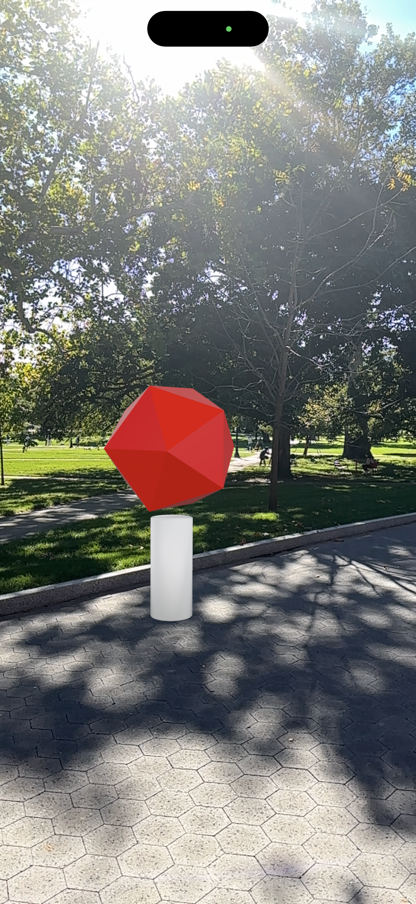

# Found on the Oval — Starter

DESIGN 4106 · Intro to AR Training 2



A .glb stays locked until your phone's GPS says you are at the spot. Then it opens in [model-viewer](https://modelviewer.dev), with a **View in AR** button. One HTML file, no install.

## Test on your computer (VS Code + Live Server)

1. Open the project folder in VS Code
2. Make sure you have the **Live Server** extension (Extensions panel → search "Live Server" → Install)
3. Right-click `index.html` → **Open with Live Server**
4. Add `?fake` to the address (e.g. `http://127.0.0.1:5500/index.html?fake`) and click Start. It simulates walking in from 60 m.

## Test on location (GitHub Pages)

1. Push your project to your GitHub repo
2. On the repo page: **Settings → Pages → Source: Deploy from a branch → `main` / `(root)` → Save**
3. Wait a minute, then open `https://<your-username>.github.io/<your-repo>/` on your phone
4. Tap Start and allow location. Walk to your spot.

Each time you push, the page updates within a minute or two.

## Edit

| File | What |
|---|---|
| `index.html` → `TARGET` | your spot's latitude/longitude |
| `index.html` → `RADIUS` | how close (metres) before it opens |
| `models/object.glb` | your model (replace the placeholder, keep the name) |

**Finding your coordinates:** stand on your spot with the page open; it prints your live coordinates. Wait for ±10 m or better, then paste them into `TARGET`.

## How it works

```js
navigator.geolocation.watchPosition(onPosition);   // GPS listener
// in onPosition: if distance to TARGET < RADIUS → show <model-viewer>
```

## My project Deliverables

- **Title**
- **Live page: your url**
- **Coordinates: your spot coordinates**
- **Intent: in one line -- how does your 3d object respond to the qualities of the spot**
- **Screenshot: .png or .jpg**
- **SUBMIT ON CARMEN–Video: .mp4, stable shot, < 2 min.**